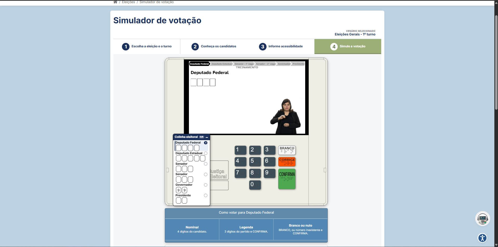

# Apresentação do Sistema

## Qual sistema será avaliado?
O sistema avaliado é o **Simulador de Votação na Urna Eletrônica**, uma aplicação web oficial desenvolvida pelo Tribunal Superior Eleitoral (TSE). Trata-se de uma interface interativa que reproduz o comportamento e o visual da urna eletrônica real utilizada nas eleições brasileiras.

*Figura 1 - Tela inicial do simulador do TSE.*

## Qual é o domínio do sistema?
O sistema está inserido no domínio de **Serviços Governamentais e Cidadania**.

## Qual é a finalidade do sistema?
Sua finalidade é pedagógica e informativa. O simulador permite que os eleitores treinem e se familiarizem com a interface da urna eletrônica antes do dia da eleição, ajudando a reduzir erros, agilizar a votação e dar segurança ao cidadão na hora de registrar o seu voto.

## Quem são os principais usuários do sistema?
Os usuários são **todos os cidadãos brasileiros com direito ao voto**. Isso abrange um público extremamente vasto e diverso, incluindo desde jovens votando pela primeira vez até idosos e pessoas com diferentes níveis de letramento digital ou necessidades de acessibilidade.

## Quais são as principais funcionalidades do sistema?
As funcionalidades mais relevantes para a compreensão do sistema incluem:
* **Teclado Virtual Interativo:** Reprodução das teclas numéricas (0 a 9) e das teclas de ação (Branco, Corrige e Confirma).
* **Feedback Visual e Sonoro:** Exibição da foto, nome, partido e cargo do candidato fictício, além da reprodução dos avisos sonoros clássicos da urna (toques curtos ao digitar e o som prolongado ao confirmar o voto).
* **Configuração de Cenários:** Escolha entre diferentes tipos de pleito (Eleições Gerais ou Municipais, 1º e 2º turnos).
* **Colinha Eleitoral:** Subpágina que permite ao eleitor anotar previamente os números dos candidatos, simulando a "cola" que muitos levam no dia da votação.
* **Recursos de Acessibilidade:** Opção para ativar instruções por áudio para simular o uso da urna por pessoas com deficiência visual.

## Qual será o escopo da avaliação?
O escopo das avaliações focou na **jornada principal de votação no cenário de Eleições Gerais (1º turno)** (Deputado Federal, Deputado Estadual, Senador, Governador e Presidente). Foram analisados fluxos como a inserção correta dos números, a utilização das teclas de correção, do voto em branco e do voto nulo, a clareza das mensagens da interface (feedback), o uso da colinha eleitoral e a facilidade de encontrar e ativar o recurso de acessibilidade de áudio.
