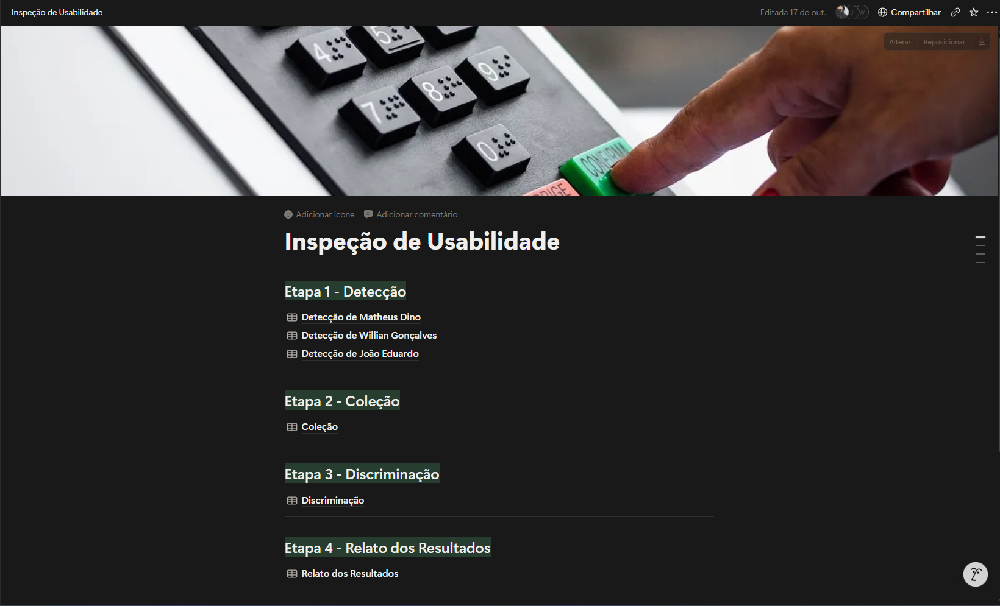

## Avaliação Heurística

### Método utilizado
A Avaliação Heurística é um método de inspeção de usabilidade criado por Jakob Nielsen, onde um pequeno grupo de avaliadores (especialistas) examina a interface e avalia a sua conformidade com princípios de usabilidade reconhecidos (as heurísticas). O objetivo é identificar problemas no design da interface para que possam ser corrigidos, melhorando a experiência de uso antes ou depois do sistema ser lançado.

### Heurísticas de Nielsen
Para esta inspeção, foram utilizadas as 10 heurísticas de usabilidade de Jakob Nielsen:
1. **Visibilidade do status do sistema:** O sistema deve manter os utilizadores informados sobre o que está acontecendo, através de feedback em tempo real.
2. **Compatibilidade do sistema com o mundo real:** O sistema deve falar a linguagem do utilizador, com palavras e conceitos que sejam familiares, seguindo convenções do mundo real.
3. **Controlo e liberdade do utilizador:** O sistema deve fornecer "saídas de emergência" claras para os utilizadores saírem rapidamente de estados indesejados.
4. **Consistência e padrões:** Os utilizadores não devem ter de adivinhar se diferentes palavras, situações ou ações significam a mesma coisa.
5. **Prevenção de erros:** Um design cuidadoso que previna a ocorrência de erros é melhor do que boas mensagens de erro.
6. **Reconhecer em vez de relembrar:** Minimizar a carga de memória do utilizador, mantendo objetos, ações e opções visíveis. 
7. **Flexibilidade e eficiência de uso:** Fornecer atalhos que permitam aos utilizadores experientes executar tarefas mais rapidamente.
8. **Estética e design minimalista:** Os diálogos não devem conter informações irrelevantes ou raramente necessárias.
9. **Ajudar os utilizadores a reconhecer, diagnosticar e corrigir erros:** As mensagens de erro devem ser expressas em linguagem clara, indicando o problema com precisão e sugerindo uma solução.
10. **Ajuda e documentação:** Embora seja melhor que o sistema possa ser usado sem documentação, pode ser necessário fornecer ajuda estruturada, facilmente pesquisável e focada na tarefa.

### Processo de inspeção
A inspeção foi realizada no **Simulador de Urna Eletrónica do TSE**. A equipe (Matheus, João e Willian) executou o processo dividindo-o em quatro etapas principais, documentadas e validadas de forma colaborativa:
* **Etapa 1 - Detecção:** Cada inspetor navegou pelo simulador de forma individua, livre e independente, sem roteiro de tarefas pré-definido, identificando possíveis problemas de usabilidade e associando-os à heurística violada.
* **Etapa 2 - Coleção:** A equipe reuniu-se remotamente (via Google Meet) para unificar as tabelas individuais, agrupando as discrepâncias para identificar quais foram únicas ou repetidas pelos avaliadores.
* **Etapa 3 - Discriminação:** Os problemas levantados foram analisados em conjunto para filtrar os apontamentos, classificando-os como Defeitos reais de usabilidade ou Falsos Positivos.
* **Etapa 4 - Relato dos Resultados:** Para cada defeito validado, foi atribuído um Grau de Severidade (de 1 a 4) com base no seu impacto na experiência do utilizador, juntamente com propostas de melhoria para os programadores do sistema.

### Registros da avaliação

Equipe reunida remotamente realizando a inspeção.

---

Ambiente do Notion que contem as 4 etapas.

[Clique aqui para ter acesso as tabelas da Inspeção](https://app.notion.com/p/Inspe-o-de-Usabilidade-3f79951fb4de8014848eec7a5138d432?source=copy_link)
