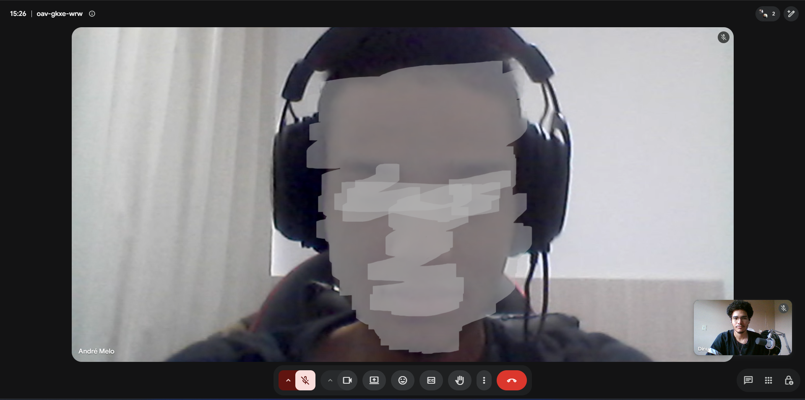
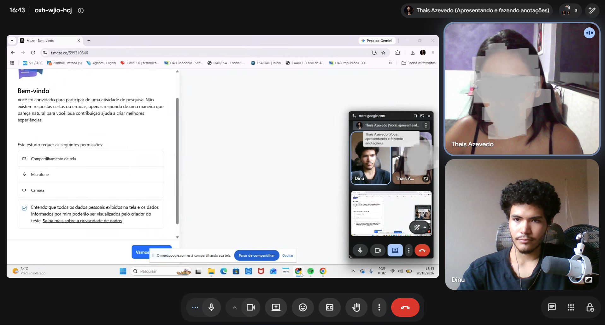

# Teste de Usabilidade

O Teste de Usabilidade foi realizado com usuários reais para avaliar o desempenho, a eficácia e a satisfação durante a interação com o Simulador de Votação na Urna Eletrônica do TSE, complementando os achados obtidos anteriormente na Inspeção de Usabilidade.

## 1. Planejamento

Esta seção apresenta o planejamento estruturado pela equipe antes da condução das sessões de teste, abrangendo a definição dos objetivos, a elaboração das tarefas, a seleção do perfil dos participantes e a preparação dos instrumentos e ferramentas de coleta.

### Objetivo do teste
O principal objetivo deste teste é avaliar a usabilidade e identificar possíveis barreiras de interação no Simulador de Urna Eletrônica do TSE. Pretende-se observar como os usuários navegam pela interface web para realizar ações comuns — como inserir números, corrigir escolhas e submeter votos em branco ou nulos —, avaliando a eficácia e a satisfação durante a simulação do fluxo eleitoral.

### Tarefas
Para simular o fluxo real de uma eleição, os participantes foram orientados a completar um percurso focado nas seguintes missões, elaboradas sem indicar diretamente os botões ou caminhos da interface:
1. Iniciar a simulação no cenário de Eleições Gerais.
2. Ativar o recurso de acessibilidade de áudio do site.
3. Abrir a subpágina e preencher a colinha eleitoral.
4. Realizar um voto direto em um candidato ou voto de legenda.
5. Digitar um número incorreto propositalmente e corrigir a escolha antes de confirmar o voto.
6. Registrar um voto em branco para um dos cargos.
7. Simular um voto nulo (inserir um número de partido inexistente) e confirmar.
8. Concluir todo o fluxo de votação até visualizar a tela de encerramento.

### Instrumentos utilizados
O teste foi conduzido de forma remota, contando com a colaboração de 8 participantes externos à equipe (além de 1 participante externo exclusivo para o teste piloto), selecionados de acordo com o perfil de cidadãos aptos ao voto. Todo o processo foi executado no ambiente web, recorrendo à seguinte estrutura de instrumentos e ferramentas:
- **Termo de Consentimento Livre e Esclarecido (TCLE):** Apresentado e assinado por todos os participantes antes do início das sessões para autorizar a coleta de dados e imagens. Em conformidade com as diretrizes éticas e da disciplina, os documentos assinados foram enviados separadamente e não estão publicados neste repositório.
- **Simulador da Urna Eletrônica (TSE):** O sistema-alvo onde as tarefas foram efetivamente realizadas.
- **Maze:** Plataforma principal configurada para a estruturação sequencial das tarefas e coleta de métricas comportamentais, além da aplicação do questionário de caracterização (pré-teste) e das cinco perguntas abertas (pós-teste).
- **Google Forms / UEQ (User Experience Questionnaire):** Instrumentos utilizados para a coleta complementar de caracterização do perfil dos participantes (pré-teste) e para a avaliação padronizada de satisfação e experiência de uso (pós-teste).
- **Google Meet:** Utilizado para o acompanhamento das sessões remotas, permitindo o compartilhamento de tela, a observação do percurso sem interferência dos avaliadores e o registro de evidências.

Com o planejamento concluído e os instrumentos devidamente verificados na ferramenta Maze, a equipe avançou para a validação do protocolo por meio do Teste Piloto.

---

## 2. Teste Piloto

Antes de iniciar as sessões oficiais com os 8 participantes, a equipe realizou um Teste Piloto com 1 voluntário externo (que não compôs a amostra final). O piloto seguiu rigorosamente todo o rito planejado — assinatura do TCLE, preenchimento do questionário de caracterização, execução das 8 tarefas no Maze e resposta ao questionário pós-teste — com o objetivo de validar a clareza das instruções, o tempo de sessão e o funcionamento dos links e fluxos.

*Figura 1 - Participante durante a realização do Teste Piloto (identidade preservada).*

### Ajustes realizados
A partir da observação do Teste Piloto, foi ajustado o passo a passo dentro do Maze, adicionando mais alguns passos contextuais para ajudar na interpretação das missões sem induzir a resposta. Além disso, foi elaborada uma mensagem padronizada para o envio dos links aos voluntários.

Após a implementação e verificação desses ajustes na plataforma, o protocolo de testes foi considerado validado e pronto para a aplicação oficial.

---

## 3. Execução

Nesta etapa, o Teste de Usabilidade foi executado com os 8 participantes selecionados, seguindo de forma padronizada a sequência validada no piloto: leitura e assinatura do TCLE, resposta ao questionário de caracterização, execução das 8 tarefas propostas sem intervenção da equipe e preenchimento do questionário pós-teste (UEQ e 5 perguntas abertas).

### Evidências
A seguir, são apresentadas as evidências fotográficas registradas durante as sessões de teste, com os rostos dos participantes devidamente desfocados/ocultados para preservar sua identidade:

*Figura 2 - Participante P01 durante a realização do teste.*

*Figura 3 - Participante P02 durante a realização do teste.*

Finalizadas todas as sessões de execução e garantido o registro completo das interações, os dados brutos foram extraídos para a etapa de análise e consolidação.

---

## 4. Análise dos Resultados

Nesta seção, os dados quantitativos e qualitativos coletados durante o Teste de Usabilidade são organizados e discutidos. A análise contempla o desempenho individual de cada participante, o resumo comparativo entre usuários, a consolidação de métricas por tarefa e a relação com os relatos abertos do pós-teste.

**Legenda dos resultados**

| Símbolo | Significado |
| :--- | :--- |
| ✓ | O usuário conseguiu completar a tarefa |
| ! | O usuário completou a tarefa, mas com dificuldade |
| X | O usuário não conseguiu completar a tarefa |

**Erros:** quantidade de ações incorretas registradas durante a tarefa (por exemplo, cliques em lugares errados ou tentativas sem sucesso).

### Resultados por participante

As tabelas abaixo detalham o desempenho individual de cada um dos 8 participantes nas tarefas propostas, incluindo o tempo de execução, o resultado obtido, a contagem de erros e as observações comportamentais registradas.

**Participante P01**

| Tarefa | Tempo (em segundos) | Resultado da tarefa | Erros | Observações |
| :--- | :--- | :--- | :--- | :--- |
| M1: Iniciar simulação | 10 | ! | 1 | O usuário iniciou clicando em um lugar errado, mas percebeu e voltou atrás |
| M2: Ativar áudio | 15 | X | 3 | O usuário não conseguiu ativar o áudio e não achou a opção |
| M3: Abrir colinha | 34 | ! | 2 | O usuário demorou para entender a colinha |
| M4: Votar Dep. Federal | 82 | ! | 2 | O usuário teve uma breve confusão sobre o cargo, mas rapidamente sanada |
| M5: Corrigir Dep. Estadual | 32 | ! | 1 | O usuário sentiu dificuldade em corrigir |
| M6: Votar em Branco (Senador) | 50 | ! | 3 | O usuário sentiu dificuldade com a relação de ter de votar em dois senadores, pois o sistema evidencia pouco |
| M7: Votar Nulo (Governador) | 56 | ! | 1 | O usuário sentiu dificuldade em entender que o voto registrado pelo número seria nulo |
| M8: Votar Presidente e Fim | 14 | ✓ | 0 | O usuário teve êxito |

**Participante P02**

| Tarefa | Tempo (em segundos) | Resultado da tarefa | Erros | Observações |
| :--- | :--- | :--- | :--- | :--- |
| M1: Iniciar simulação | 10 | X | 1 | O usuário iniciou a simulação errada por erro de especificação do site |
| M2: Ativar áudio | 88 | ! | 0 | O usuário teve um pouco de demora, mas resolveu sem nenhum erro |
| M3: Abrir colinha | 83 | ! | 0 | O usuário abriu e preencheu sua colinha |
| M4: Votar Dep. Federal | 56 | X | 1 | Usuário ficou perdido devido ao tipo de votação escolhida não constar Deputado Federal; após perceber, prosseguiu |
| M5: Corrigir Dep. Estadual | 20 | X | 1 | O usuário pulou a etapa, pois não constava Deputado Estadual no tipo de eleição escolhido |
| M6: Votar em Branco (Senador) | 7 | X | 1 | O usuário pulou a etapa, pois não constava Senador no tipo de eleição escolhido |
| M7: Votar Nulo (Governador) | 18 | ✓ | 0 | O usuário entendeu o voto nulo e prosseguiu |
| M8: Votar Presidente e Fim | 17 | ✓ | 0 | Concluiu com êxito |

**Participante P03**

| Tarefa | Tempo (em segundos) | Resultado da tarefa | Erros | Observações |
| :--- | :--- | :--- | :--- | :--- |
| M1: Iniciar simulação | 66 | ! | 3 | Usuário vagou pelas opções erradas porque o site não especificava bem para qual ele deveria ir |
| M2: Ativar áudio | 10 | X | 1 | Não achou a opção de ativar o áudio e não sabia que existia |
| M3: Abrir colinha | 43 | ! | 3 | Demorou para entender como a colinha funcionava |
| M4: Votar Dep. Federal | 23 | ! | 1 | Demorou para entender que tinha começado |
| M5: Corrigir Dep. Estadual | 15 | X | 1 | Saiu sem corrigir |
| M6: Votar em Branco (Senador) | 47 | ! | 1 | Demorou para entender que eram dois senadores |
| M7: Votar Nulo (Governador) | 31 | ! | 0 | Demorou para entender que o número inserido votaria nulo |
| M8: Votar Presidente e Fim | 10 | ✓ | 0 | Concluiu a etapa com êxito |

**Participante P04**

| Tarefa | Tempo (em segundos) | Resultado da tarefa | Erros | Observações |
| :--- | :--- | :--- | :--- | :--- |
| M1: Iniciar simulação | 8 | ✓ | 0 | Entendeu rápido onde clicar |
| M2: Ativar áudio | 7 | X | 1 | Não achou onde clicar |
| M3: Abrir colinha | 98 | ! | 3 | Conseguiu com muita dificuldade devido à confusão causada dentro do site |
| M4: Votar Dep. Federal | 142 | ! | 2 | Demorou devido ao carregamento do site |
| M5: Corrigir Dep. Estadual | 87 | ! | 2 | Conseguiu com dificuldades, pois não sabia exatamente onde clicar |
| M6: Votar em Branco (Senador) | 53 | ! | 0 | Conseguiu realizar a atividade, porém se confundiu com as duas vagas |
| M7: Votar Nulo (Governador) | 46 | ! | 1 | Demorou para entender que o número digitado votaria nulo e tentou corrigir |
| M8: Votar Presidente e Fim | 21 | ✓ | 0 | Teve êxito na etapa |

**Participante P05**

| Tarefa | Tempo (em segundos) | Resultado da tarefa | Erros | Observações |
| :--- | :--- | :--- | :--- | :--- |
| M1: Iniciar simulação | 80 | ! | 1 | Teve dificuldade de saber onde clicar, e o site demorou para carregar |
| M2: Ativar áudio | 8 | X | 1 | Não encontrou o botão de ativar áudio e nem sabia da funcionalidade |
| M3: Abrir colinha | 146 | ! | 4 | Teve muita dificuldade com a colinha, pois não sabia como corrigir somente um erro e, além disso, não entendeu o sistema de colinha |
| M4: Votar Dep. Federal | 63 | ✓ | 0 | Demorou devido ao carregamento do site |
| M5: Corrigir Dep. Estadual | 14 | X | 1 | Não corrigiu e seguiu adiante |
| M6: Votar em Branco (Senador) | 22 | X | 2 | Não conseguiu votar em branco, pois não entendeu o sistema |
| M7: Votar Nulo (Governador) | 41 | ! | 1 | Não entendeu como iria registrar o voto nulo, mas no fim conseguiu |
| M8: Votar Presidente e Fim | 21 | ✓ | 1 | Teve êxito na etapa |

**Participante P06**

| Tarefa | Tempo (em segundos) | Resultado da tarefa | Erros | Observações |
| :--- | :--- | :--- | :--- | :--- |
| M1: Iniciar simulação | 24 | ! | 1 | Teve dificuldade de encontrar onde clicar e clicou no lugar errado, porém conseguiu retornar |
| M2: Ativar áudio | 5 | X | 1 | Não encontrou o botão de ativar áudio e nem sabia da funcionalidade |
| M3: Abrir colinha | 86 | ! | 5 | Teve dificuldades em corrigir números errados |
| M4: Votar Dep. Federal | 32 | ✓ | 0 | Percorreu tranquilamente |
| M5: Corrigir Dep. Estadual | 31 | ! | 1 | Teve dificuldades em corrigir o número |
| M6: Votar em Branco (Senador) | 26 | ! | 1 | Demorou para entender que eram dois senadores |
| M7: Votar Nulo (Governador) | 30 | ! | 1 | Não conseguiu entender que o voto seria nulo, mas o fez mesmo assim |
| M8: Votar Presidente e Fim | 9 | ✓ | 0 | Concluiu com êxito |

**Participante P07**

| Tarefa | Tempo (em segundos) | Resultado da tarefa | Erros | Observações |
| :--- | :--- | :--- | :--- | :--- |
| M1: Iniciar simulação | 8 | ✓ | 0 | O usuário conseguiu iniciar sem erros |
| M2: Ativar áudio | 41 | ! | 2 | O usuário teve certa dificuldade para ativar o áudio, mas conseguiu no fim |
| M3: Abrir colinha | 37 | ✓ | 0 | O usuário abriu a colinha e a preencheu sem dificuldades |
| M4: Votar Dep. Federal | 43 | ✓ | 0 | O usuário não teve dificuldades, porém o site demorou para carregar |
| M5: Corrigir Dep. Estadual | 26 | ! | 1 | O usuário teve um pouco de dificuldade com a correção, mas concluiu |
| M6: Votar em Branco (Senador) | 12 | ✓ | 0 | O usuário conseguiu sem problemas |
| M7: Votar Nulo (Governador) | 15 | ✓ | 0 | Entendeu rápido e registrou o voto |
| M8: Votar Presidente e Fim | 12 | ✓ | 0 | Concluiu com êxito |

**Participante P08**

| Tarefa | Tempo (em segundos) | Resultado da tarefa | Erros | Observações |
| :--- | :--- | :--- | :--- | :--- |
| M1: Iniciar simulação | 13 | ✓ | 0 | Iniciou sem erros |
| M2: Ativar áudio | 56 | X | 4 | O usuário procurou e tentou ativar, porém não conseguiu e prosseguiu sem |
| M3: Abrir colinha | 16 | ! | 1 | Usuário abriu a colinha, porém não a preencheu |
| M4: Votar Dep. Federal | 24 | ✓ | 0 | O usuário votou sem problemas |
| M5: Corrigir Dep. Estadual | 28 | ! | 0 | Usuário demorou um pouco para entender onde corrigia, mas conseguiu |
| M6: Votar em Branco (Senador) | 18 | ✓ | 0 | Votou tranquilamente em branco |
| M7: Votar Nulo (Governador) | 14 | ✓ | 0 | Entendeu rapidamente a mensagem e registrou |
| M8: Votar Presidente e Fim | 13 | ✓ | 0 | Registrou o voto sem problemas |

De modo geral, os registros individuais evidenciam que problemas na escolha inicial do cenário (como ocorreu com P02 na tarefa M1) impactam em cascata as tarefas subsequentes, além de demonstrarem que a localização do recurso de áudio (M2) e a interação com a colinha eleitoral (M3) foram pontos recorrentes de atrito.

---

### Resumo por participante

Esta tabela consolida o desempenho geral de todos os usuários que realizaram o teste, somando os sucessos, dificuldades, falhas, tempo total e total de erros de cada um.

| Participante | Sucesso ✓ | Com dificuldade ! | Insucesso X | Tempo total (s) | Total de erros |
| :--- | :--- | :--- | :--- | :--- | :--- |
| P01 | 1 | 6 | 1 | 293 | 13 |
| P02 | 2 | 2 | 4 | 299 | 4 |
| P03 | 1 | 5 | 2 | 245 | 10 |
| P04 | 2 | 5 | 1 | 462 | 9 |
| P05 | 2 | 3 | 3 | 395 | 11 |
| P06 | 2 | 5 | 1 | 243 | 10 |
| P07 | 6 | 2 | 0 | 194 | 3 |
| P08 | 5 | 2 | 1 | 182 | 5 |

Observa-se uma variação expressiva de desempenho entre os perfis: enquanto P07 e P08 concluíram a maioria das tarefas sem dificuldades e com baixo tempo total (194 s e 182 s, respectivamente), participantes como P01, P03, P04 e P06 conseguiram avançar pelo fluxo, mas enfrentaram dificuldades (`!`) na maior parte das etapas, acumulando entre 9 e 13 erros.

---

### Consolidação por tarefa

A tabela seguinte apresenta a taxa de sucesso e o tempo médio gasto em cada missão, permitindo identificar quais etapas do simulador geraram mais atrito geral. O TSR considera como sucesso as tarefas concluídas, com ou sem dificuldade (✓ e !); apenas o X conta como insucesso.

| Tarefa | TSR - Taxa de Sucesso (%) | TTR - Tempo médio da tarefa (s) |
| :--- | :--- | :--- |
| M1: Iniciar simulação | 87,5% | 27,4 |
| M2: Ativar áudio | 25,0% | 28,8 |
| M3: Abrir colinha | 100,0% | 67,9 |
| M4: Votar Dep. Federal | 87,5% | 58,1 |
| M5: Corrigir Dep. Estadual | 62,5% | 31,6 |
| M6: Votar em Branco (Senador) | 75,0% | 29,4 |
| M7: Votar Nulo (Governador) | 100,0% | 31,4 |
| M8: Votar Presidente e Fim | 100,0% | 14,6 |

A consolidação por tarefa confirma que a **M2 (Ativar áudio)** apresentou a menor Taxa de Sucesso (25,0%), refletindo a baixa visibilidade do botão de acessibilidade na interface. Por outro lado, tarefas com 100% de conclusão, como **M3 (Abrir colinha)**, registraram o maior tempo médio de execução (67,9 s), indicando que mesmo funcionalidades concluídas exigiram alto esforço cognitivo e tempo de exploração por parte dos usuários. Já a **M8 (Votar Presidente e Fim)** obteve 100% de sucesso sem dificuldades e o menor tempo médio (14,6 s), demonstrando forte aprendizado da interface ao final do fluxo.

---

### Respostas abertas e fatores de usabilidade

Ao final da sessão, os participantes responderam a cinco perguntas abertas sobre a experiência com o simulador. As respostas foram codificadas no ATLAS.ti e, nesta seção, são resumidas pelos fatores de usabilidade que mais apareceram. A análise completa, com as respostas originais, os códigos e as redes, está em [Avaliação de Experiência do Usuário](../02-avaliacao-ux/experiencia-de-uso.md).

| Fator de usabilidade | Participantes | O que as respostas mostram | Relação com as tarefas do teste |
| :--- | :--- | :--- | :--- |
| Clareza e facilidade de aprender | até 5 de 8 | Instruções e mensagens claras (5), facilidade de aprender e entender (4) e nenhuma dificuldade relatada (4) | M8, concluída por todos sem dificuldade |
| Intuitividade e instruções | 2 de 8 | Dificuldade de seguir instruções e pouca intuitividade (P01 e P07) | Dificuldades de início e de entendimento do fluxo (M1, M3 e M4) |
| Mensagem do voto nulo | 1 de 8 | A mensagem do voto nulo não ficou clara (P07) | M7, concluída com dificuldade por 5 de 8 |
| Correção na colinha | 1 de 8 | Dificuldade para corrigir na colinha (P08) | M3 (7 de 8 com dificuldade) e M5 (3 de 8 não concluíram) |
| Progressão entre etapas | 1 de 8 | Dificuldade de prosseguir depois de um passo (P08) | M4 ("demorou para entender que tinha começado") |
| Praticidade e agilidade | 3 de 8 | Uso prático e rápido (P02, P03 e P04) | M8, a mais rápida (14,6 s em média) |
| Segurança para votar | 8 de 8 | Todos se sentiriam preparados para votar | — |

As respostas foram, em geral, positivas, e os poucos problemas apontados coincidem com as tarefas em que o teste registrou mais dificuldade. Há, porém, uma diferença entre o relato e o desempenho: apenas 21 das 64 tarefas foram concluídas sem dificuldade e 13 não foram concluídas. O P05, por exemplo, disse não ter tido dificuldade, mas teve 4 erros na tarefa da colinha e não concluiu as tarefas M5 e M6. Isso sugere que os problemas de usabilidade observados nem sempre aparecem espontaneamente nas respostas abertas e reforça a importância de combinar observação e relato.

---

### Considerações sobre o Teste de Usabilidade

O simulador oferece uma experiência de uso positiva: foi percebido como eficiente, atraente e estimulante, e todos os participantes disseram que se sentiriam preparados para votar. Os pontos que mais merecem atenção são a visibilidade do recurso de áudio, a previsibilidade e a clareza do fluxo — em especial a mensagem do voto nulo, a correção na colinha, a indicação de duas vagas para Senador e a progressão entre etapas —, que coincidem com as dificuldades registradas no teste de usabilidade e com a menor avaliação do UEQ. Como a amostra é pequena, os resultados indicam tendências relevantes de melhoria para o sistema e podem ser expandidos com novos perfis de usuários.
