# Teste de Usabilidade

## 1. Planejamento
### Objetivo do teste
O principal objetivo deste teste é avaliar a usabilidade e identificar possíveis barreiras de interação no Simulador de Urna Eletrônica do TSE. Pretende-se observar como os usuários navegam pela interface web para realizar ações comuns — como inserir números, corrigir escolhas e submeter votos em branco ou nulos —, avaliando a eficácia e a satisfação durante a simulação do fluxo eleitoral.

### Tarefas
Para simular o fluxo real de uma eleição, os participantes foram orientados a completar um percurso focado nas seguintes missões:
1. Iniciar a simulação no cenário de Eleições Gerais.
2. Ativar o recurso de acessibilidade de áudio do site.
3. Abrir a subpágina e preencher a colinha eleitoral.
4. Realizar um voto direto em um candidato ou voto de legenda.
5. Digitar um número incorreto propositadamente e utilizar a tecla "Corrige".
6. Registrar um voto em "Branco" para um dos cargos.
7. Simular um voto nulo (inserir um número de partido inexistente) e confirmar.
8. Concluir todo o fluxo de votação até visualizar a tela final ("FIM").

### Instrumentos utilizados
O teste foi conduzido de forma remota, contando com a colaboração de 8 participantes. Todo o processo foi executado diretamente no ambiente web, recorrendo à seguinte estrutura de ferramentas:
* **Simulador da Urna Eletrônica (TSE):** O sistema alvo onde as tarefas foram efetivamente realizadas.
* **Maze:** Plataforma principal para a estruturação das tarefas e coleta de métricas comportamentais não moderadas. As cinco perguntas abertas do pós-teste também foram aplicadas no Maze, de onde as respostas foram retiradas.
* **Google Meet:** Utilizado para a condução das sessões remotas, permitindo o compartilhamento de tela, a observação do percurso e a comunicação em tempo real.
* **Google Forms:** Ferramenta escolhida para a aplicação do questionário de caracterização do perfil (pré-teste) e para o formulário de satisfação (pós-teste).

## 2. Teste Piloto
### Ajustes realizados
Foi ajustado o passo a passo dentro do Maze, adicionando mais alguns passos contextuais, pra ajudar na interpretação. Além disso foi elaborada uma mensagem personalizada para passar os links para o voluntário. 

## 3. Execução
### Evidências
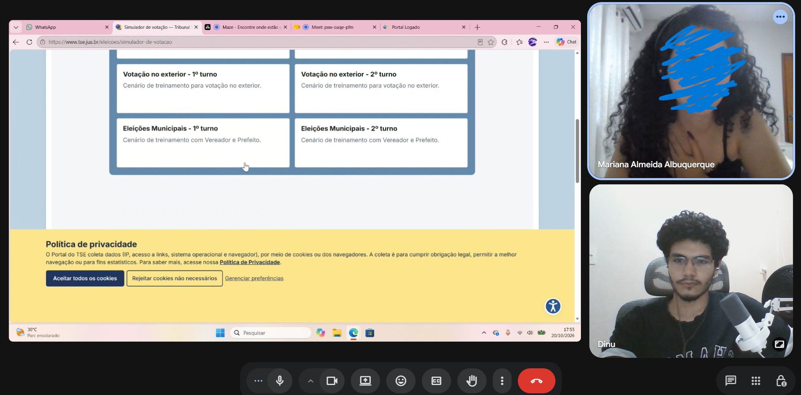
*Figura 1 - Participante durante a realização do teste.*

## 4. Análise dos Resultados

**Legenda dos resultados**

| Símbolo | Significado |
| :--- | :--- |
| ✓ | O usuário conseguiu completar a tarefa |
| ! | O usuário completou a tarefa, mas com dificuldade |
| X | O usuário não conseguiu completar a tarefa |

**Erros:** quantidade de ações incorretas registradas durante a tarefa (por exemplo, cliques em lugares errados ou tentativas sem sucesso).

### Resultados por participante

As tabelas abaixo detalham o desempenho individual de cada um dos 8 participantes nas tarefas propostas, incluindo o tempo de execução e os erros cometidos.

**Participante P01**

| Tarefa | Tempo (em segundos) | Resultado da tarefa | Erros | Observações |
| :--- | :--- | :--- | :--- | :--- |
| M1: Iniciar simulação | 10 | ! | 1 | O usuário iniciou clicando em um lugar errado, mas percebeu e voltou atrás |
| M2: Ativar áudio | 15 | X | 3 | O usuário não conseguiu ativar o áudio e não achou a opção |
| M3: Abrir colinha | 34 | ! | 2 | O usuário demorou pra entender a colinha |
| M4: Votar Dep. Federal | 82 | ! | 2 | O usuário teve uma breve confusão sobre o cargo, mas rapidamente sanada |
| M5: Corrigir Dep. Estadual | 32 | ! | 1 | O usuário sentiu dificuldade em corrigir |
| M6: Votar em Branco (Senador) | 50 | ! | 3 | O usuário sentiu dificuldade com a relação de ter de votar em dois senadores, pois o sistema evidencia pouco |
| M7: Votar Nulo (Governador) | 56 | ! | 1 | O usuário sentiu dificuldade em entender que o voto registrado pelo número seria nulo |
| M8: Votar Presidente e Fim | 14 | ✓ | 0 | O usuário teve êxito |

**Participante P02**

| Tarefa | Tempo (em segundos) | Resultado da tarefa | Erros | Observações |
| :--- | :--- | :--- | :--- | :--- |
| M1: Iniciar simulação | 10 | X | 1 | O usuário iniciou a simulação errada por erro de especificação do site |
| M2: Ativar áudio | 88 | ! | 0 | O usuário teve um pouco de demora, mas resolveu sem nenhum erro |
| M3: Abrir colinha | 83 | ! | 0 | O usuário abriu e preencheu sua colinha |
| M4: Votar Dep. Federal | 56 | X | 1 | Usuário ficou perdido devido ao tipo de votação escolhida não constar Deputado Federal, após perceber, prosseguiu |
| M5: Corrigir Dep. Estadual | 20 | X |  1 | O usuário pulou a etapa pois não constava Deputado Estadual no tipo de eleição escolhido |
| M6: Votar em Branco (Senador) | 7 | X | 1 | O usuário pulou a etapa pois não constava Senador no tipo de eleição escolhido |
| M7: Votar Nulo (Governador) | 18 | ✓ | 0 | O usuário entendeu o voto nulo, e prosseguiu |
| M8: Votar Presidente e Fim | 17 | ✓ | 0 | Concluiu com êxito |

**Participante P03**

| Tarefa | Tempo (em segundos) | Resultado da tarefa | Erros | Observações |
| :--- | :--- | :--- | :--- | :--- |
| M1: Iniciar simulação | 66 | ! | 3 | Usuário vagou pelas opções erradas porque o site não especificava bem qual ele deveria ir |
| M2: Ativar áudio | 10 | X | 1 | Não achou a opção de ativar o áudio e não sabia que existia |
| M3: Abrir colinha | 43 | ! | 3 | demorou pra entender como a colinha funcionava |
| M4: Votar Dep. Federal | 23 | ! | 1 | Demorou pra entender que tinha começado |
| M5: Corrigir Dep. Estadual | 15 | X | 1 | Saiu sem corrigir |
| M6: Votar em Branco (Senador) | 47 | ! | 1 | Demorou pra entender que eram dois senadores |
| M7: Votar Nulo (Governador) | 31 | ! | 0 | Demorou pra entender que o número inserido votaria nulo |
| M8: Votar Presidente e Fim | 10 | ✓ | 0 | Concluiu a etapa com êxito |

**Participante P04**

| Tarefa | Tempo (em segundos) | Resultado da tarefa | Erros | Observações |
| :--- | :--- | :--- | :--- | :--- |
| M1: Iniciar simulação | 8 | ✓ | 0 | Entendeu rápido aonde clicar |
| M2: Ativar áudio | 7 | X | 1 | Não achou aonde |
| M3: Abrir colinha | 98 | ! | 3 | Conseguiu com muita dificuldade devido a confusão causada dentro do site |
| M4: Votar Dep. Federal | 142 | ! | 2 | Demorou devido ao carregamento do site |
| M5: Corrigir Dep. Estadual | 87 | ! | 2 | Conseguiu com dificuldades pois não sabia exatamente aonde clicar |
| M6: Votar em Branco (Senador) | 53 | ! | 0 | Conseguiu realizar a atividade porém se confundiu com as duas vagas |
| M7: Votar Nulo (Governador) | 46 | ! | 1 | Demorou pra entender que o número digitado votaria nulo e tentou corrigir |
| M8: Votar Presidente e Fim | 21 | ✓ | 0 | Teve êxito na etapa |

**Participante P05**

| Tarefa | Tempo (em segundos) | Resultado da tarefa | Erros | Observações |
| :--- | :--- | :--- | :--- | :--- |
| M1: Iniciar simulação | 80 |  ! | 1 | Teve dificuldade de saber aonde clicar, e o site demorou pra carregar |
| M2: Ativar áudio | 8 | X | 1 | Não encontrou o botão de ativar áudio, e nem sabia da funcionalidade |
| M3: Abrir colinha | 146 | ! | 4 | Teve muita dificuldade com a colinha, pois não sabia como corrigir somente um erro e além disso não entendeu o sistema de colinha |
| M4: Votar Dep. Federal | 63 | ✓ | 0 | Demorou devido carregamento do site |
| M5: Corrigir Dep. Estadual | 14 | X | 1 | Não corrigiu e seguiu adiante |
| M6: Votar em Branco (Senador) | 22 | X | 2 | Não conseguiu votar em branco pois não entendeu o sistema |
| M7: Votar Nulo (Governador) | 41 | ! | 1 | Não entendeu como iria registrar o voto nulo, mas no fim conseguiu |
| M8: Votar Presidente e Fim | 21 | ✓ | 1 | Teve êxito na etapa |

**Participante P06**

| Tarefa | Tempo (em segundos) | Resultado da tarefa | Erros | Observações |
| :--- | :--- | :--- | :--- | :--- |
| M1: Iniciar simulação | 24 | ! | 1 | Teve dificuldade de encontrar aonde clicar, e clicou no lugar errado, porém conseguiu retornar |
| M2: Ativar áudio | 5 | X | 1 | Não encontrou o botão de ativar áudio, e nem sabia da funcionalidade |
| M3: Abrir colinha | 86 | ! | 5 | Teve dificuldades em corrigir números errados |
| M4: Votar Dep. Federal | 32 | ✓ | 0 | Percorreu tranquilamente |
| M5: Corrigir Dep. Estadual | 31 | ! | 1 | Teve dificuldades com corrigir o número |
| M6: Votar em Branco (Senador) | 26 | ! | 1 | Demorou pra entender que eram dois senadores |
| M7: Votar Nulo (Governador) | 30 | ! | 1 | Não conseguiu entender que o voto seria nulo, mas o fez mesmo assim |
| M8: Votar Presidente e Fim | 9 | ✓ | 0 | Concluiu com êxito |

**Participante P07**

| Tarefa | Tempo (em segundos) | Resultado da tarefa | Erros | Observações |
| :--- | :--- | :--- | :--- | :--- |
| M1: Iniciar simulação | 8 | ✓ | 0 | O usuário conseguiu iniciar sem erros |
| M2: Ativar áudio | 41 | ! | 2 | O usuário teve certa dificuldade para ativar o áudio, mas conseguiu no fim |
| M3: Abrir colinha | 37 | ✓ | 0 | O usuário abriu a colinha e a preencheu sem dificuldades |
| M4: Votar Dep. Federal | 43 | ✓ | 0 | O usuário não teve dificuldades porém o site demorou pra carregar |
| M5: Corrigir Dep. Estadual | 26 | ! | 1 | O usuário teve um pouco de dificuldade com a correção, mas concluiu |
| M6: Votar em Branco (Senador) | 12 | ✓ | 0 | O usuário conseguiu sem problemas |
| M7: Votar Nulo (Governador) | 15 | ✓ | 0 | Entendeu rápido e registrou o voto |
| M8: Votar Presidente e Fim | 12 | ✓ | 0 | Concluiu com êxito |

**Participante P08**

| Tarefa | Tempo (em segundos) | Resultado da tarefa | Erros | Observações |
| :--- | :--- | :--- | :--- | :--- |
| M1: Iniciar simulação | 13 | ✓ | 0 | Iniciou sem erros |
| M2: Ativar áudio | 56 | X | 4 | O usuário procurou e tentou ativar, porém não conseguiu e prosseguiu sem |
| M3: Abrir colinha | 16 | ! | 1 | Usuário abriu a colinha, porém não a preencheu |
| M4: Votar Dep. Federal | 24 | ✓ | 0 | O usuário votou sem problemas |
| M5: Corrigir Dep. Estadual | 28 | ! | 0 | Usuário demorou um pouco pra entender aonde corrigia, mas conseguiu |
| M6: Votar em Branco (Senador) | 18 | ✓ | 0 | Votou tranquilamente em branco |
| M7: Votar Nulo (Governador) | 14 | ✓ | 0 | Entendeu rapidamente a mensagem e registrou |
| M8: Votar Presidente e Fim | 13 | ✓ | 0 | Registrou o voto sem problemas |

---

### Resumo por participante

Esta tabela consolida o desempenho geral de todos os usuários que realizaram o teste, somando os sucessos, dificuldades, falhas, tempo total e total de erros de cada um.

| Participante | Sucesso ✓ | Com dificuldade ! | Insucesso X | Tempo total (s) | Total de erros |
| :--- | :--- | :--- | :--- | :--- | :--- |
| P01 | 1 | 6 | 1 | 293 | 13 |
| P02 | 2 | 2 | 4 | 299 | 4 |
| P03 | 1 | 5 | 2 | 245 | 10 |
| P04 | 2 | 5 | 1 | 462 | 9 |
| P05 | 2 | 3 | 3 | 395 | 11 |
| P06 | 2 | 5 | 1 | 243 | 10 |
| P07 | 6 | 2 | 0 | 194 | 3 |
| P08 | 5 | 2 | 1 | 182 | 5 |

---

### Consolidação por tarefa

A tabela seguinte apresenta a taxa de sucesso e o tempo médio gasto em cada missão, permitindo identificar quais as etapas do simulador que geraram mais atrito geral. O TSR considera como sucesso as tarefas concluídas, com ou sem dificuldade (✓ e !); apenas o X conta como insucesso.

| Tarefa | TSR - Taxa de Sucesso (%) | TTR - Tempo médio da tarefa (s) |
| :--- | :--- | :--- |
| M1: Iniciar simulação | 87,5% | 27,4 |
| M2: Ativar áudio | 25,0% | 28,8 |
| M3: Abrir colinha | 100,0% | 67,9 |
| M4: Votar Dep. Federal | 87,5% | 58,1 |
| M5: Corrigir Dep. Estadual | 62,5% | 31,6 |
| M6: Votar em Branco (Senador) | 75,0% | 29,4 |
| M7: Votar Nulo (Governador) | 100,0% | 31,4 |
| M8: Votar Presidente e Fim | 100,0% | 14,6 |

---

# Avaliação de Experiência do Usuário

Esta avaliação analisa a experiência de uso do Simulador de Votação na Urna Eletrônica do TSE a partir da percepção dos participantes do teste de usabilidade. Foram combinadas duas fontes: o questionário UEQ (User Experience Questionnaire), que mede a experiência em seis dimensões, e cinco perguntas abertas, analisadas no ATLAS.ti. Os resultados são discutidos em conjunto nas considerações finais.

## 1. Aplicação do UEQ

O UEQ é um questionário padronizado com 26 pares de adjetivos opostos (por exemplo, "complicado" e "fácil"), avaliados em uma escala de sete pontos, de -3 a +3, e organizados em seis dimensões:

| Dimensão | O que mede |
| :--- | :--- |
| Atratividade | Impressão geral do produto: os usuários gostam ou não dele? |
| Perspicuidade | É fácil se familiarizar com o produto e aprender a usá-lo? |
| Eficiência | É possível realizar as tarefas sem esforço desnecessário? |
| Confiabilidade | O usuário sente que controla a interação? Ela é segura e previsível? |
| Estimulação | Usar o produto é empolgante e motivador? |
| Novidade | O produto é criativo e desperta o interesse dos usuários? |

Médias acima de 0,8 indicam avaliação positiva, abaixo de -0,8, negativa, e valores intermediários, neutra. Perspicuidade, Eficiência e Confiabilidade se ligam à usabilidade clássica; Estimulação e Novidade, à experiência de uso.

O UEQ foi aplicado ao final da sessão de cada participante. As respostas de 8 participantes foram inseridas na planilha de análise do site oficial do UEQ, que calcula as médias e gera os gráficos. Além do UEQ, os participantes responderam a cinco perguntas abertas, analisadas na seção 4.

## 2. Resultados gerais

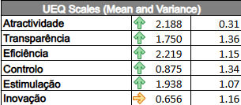

*Figura 2 - Médias (primeira coluna) e variâncias (segunda coluna) das dimensões do UEQ. Na ferramenta, Perspicuidade aparece como "Transparência", Confiabilidade como "Controlo" e Novidade como "Inovação".*

**Quadro 1 - Resultados do UEQ por dimensão**

| Dimensão | Média | Variância | Interpretação |
| :--- | :--- | :--- | :--- |
| Atratividade | 2,188 | 0,31 | Positiva |
| Perspicuidade | 1,750 | 1,36 | Positiva |
| Eficiência | 2,219 | 1,15 | Positiva |
| Confiabilidade | 0,875 | 1,34 | Positiva (próxima do limite) |
| Estimulação | 1,938 | 1,07 | Positiva |
| Novidade | 0,656 | 1,16 | Neutra |

Cinco das seis dimensões foram positivas. Eficiência (2,219) e Atratividade (2,188) tiveram as maiores médias, seguidas de Estimulação (1,938) e Perspicuidade (1,750). A Confiabilidade (0,875) foi positiva, mas perto do limite, e a Novidade (0,656) foi a única neutra. A Atratividade teve a menor variância (0,31), o que indica maior concordância entre os participantes.

**Consistência das respostas.** Dois participantes tiveram respostas inconsistentes em três escalas, limite a partir do qual os autores do UEQ sugerem considerar a exclusão dos dados. Como a amostra é pequena, todas as respostas foram mantidas. Novidade (5 participantes) e Confiabilidade (4) tiveram mais respostas inconsistentes, por isso suas médias exigem cautela.

## 3. Análise quantitativa

Entre os gráficos da planilha, foram escolhidos dois, por ajudarem a entender os pontos fortes e fracos do simulador.

### Gráfico 1 - Médias por dimensão

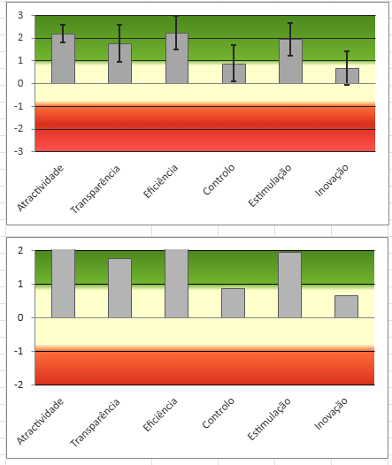

*Figura 3 - Médias das dimensões do UEQ (de -3 a +3), com barras de variação. Verde, avaliação positiva; amarelo, neutra; vermelho, negativa. Transparência = Perspicuidade, Controlo = Confiabilidade, Inovação = Novidade.*

O gráfico mostra a média de cada dimensão, com faixas de interpretação ao fundo. Eficiência, Atratividade, Estimulação e Perspicuidade estão claramente na faixa verde. A Confiabilidade (0,875) fica logo acima do limite de 0,8, e a Novidade (0,656) é a única na faixa amarela, com a variação chegando a cerca de zero. Pelo Quadro 1, a Atratividade tem a menor variância, e Perspicuidade e Confiabilidade, as maiores, o que reforça a cautela com apenas 8 participantes. Em resumo, o simulador foi percebido como eficiente e atraente, com avaliação mais modesta em previsibilidade e originalidade.

### Gráfico 2 - Médias por item

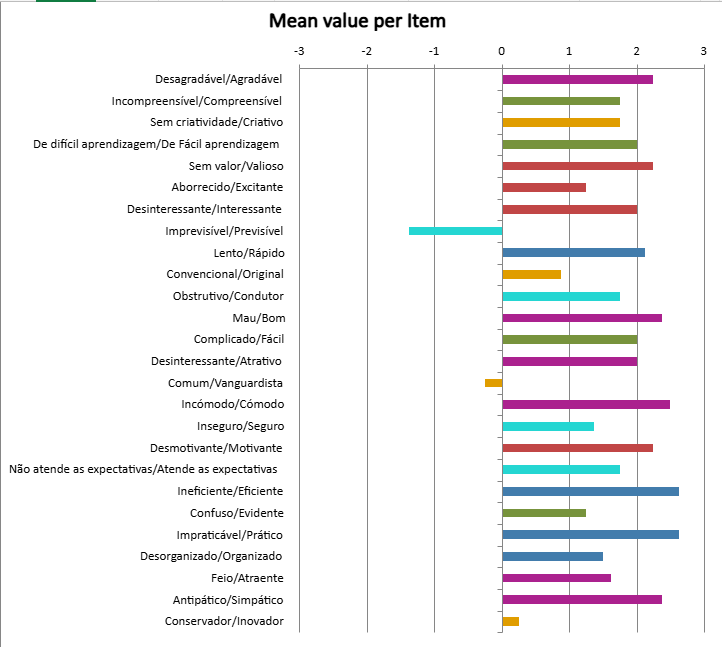

*Figura 4 - Média de cada item do UEQ (de -3 a +3). Cores por dimensão: roxo, Atratividade; verde, Perspicuidade; azul, Eficiência; ciano, Confiabilidade; vermelho, Estimulação; laranja, Novidade.*

O gráfico mostra a média dos 26 itens. A maior parte ficou no lado positivo, com destaque para "Ineficiente/Eficiente" e "Impraticável/Prático" (cerca de 2,6) e "Incómodo/Cómodo" (2,5). Três pontos destoam. "Imprevisível/Previsível", da Confiabilidade, foi o único item negativo (-1,4), o que indica que o simulador foi percebido como imprevisível em alguns momentos, de acordo com as dificuldades do teste (mensagem do voto nulo, correção e progressão entre etapas). Na Novidade, "Comum/Vanguardista" (-0,3) e "Conservador/Inovador" (0,3) ficaram perto de zero, enquanto "Sem criatividade/Criativo" teve 1,8, o que explica a avaliação neutra, coerente com um simulador que busca reproduzir a urna real.

Os dois gráficos mostram o mesmo panorama: avaliação positiva nas dimensões, com Confiabilidade e Novidade nos valores mais baixos, e a imprevisibilidade percebida como ponto mais crítico.

## 4. Análise qualitativa

As respostas às cinco perguntas abertas foram analisadas no ATLAS.ti: leitura das respostas, criação de códigos para os aspectos mencionados e relação desses códigos com as dimensões do UEQ, para verificar como os comentários explicam ou complementam os resultados quantitativos.

### 4.1 Respostas abertas analisadas

As respostas às cinco perguntas abertas foram retiradas do Maze, onde as perguntas do pós-teste foram aplicadas.

**Quadro 2 - Perguntas abertas aplicadas**

| Código | Pergunta |
| :--- | :--- |
| Q1 | O que você mais gostou ao usar o simulador? |
| Q2 | O que foi mais difícil ou confuso? |
| Q3 | Alguma mensagem ou termo não ficou claro? Qual? |
| Q4 | Depois de usar o simulador, você se sentiria preparado para votar na urna de verdade? Por quê? |
| Q5 | O que você mudaria no simulador? |

**Quadro 2.1 - Respostas por participante (originais, sem correção de grafia)**

| Part. | Q1 | Q2 | Q3 | Q4 | Q5 |
| :--- | :--- | :--- | :--- | :--- | :--- |
| P01 | é possível observar o funcionamento da urna eletrônica de forma simples | seguir instruções | não | sim, as instruções são intuitivas | está ótimo |
| P02 | A praticidade e a agilidade | nada, de fácil aprendizado | Não, ficaram todos claros | Sim, pois aqui é um bom treinamento da maneira correta de votar | Nada |
| P03 | Eu gostei da praticidade e da ajuda que teve | Não foi confuso, achei bem pratico | tudo ficou claro e bem explicado | sim, porquê consegui entender como fazer de forma bem pratica | não mudaria nada |
| P04 | Muito pratico | Absolutamente nada | Nenhum | Sim, por ter praticado de forma real | Absolutamente nada, ele é completo |
| P05 | Eu gostei de usar o botão de confirmar. | Não tive dificuldade. | Sim. Algumas apenas | Sim. Porque eu já tinha votado antes. | Eu não mudaria nada. |
| P06 | Tudo | Um pouco de tudo | Nao | Sim, pq sim | Nada |
| P07 | Achei simples | O simulador não é tão intuitivo quanto deveria | A mensagem de voto nulo | Sim, pois foi um treino bom | Deixaria ele mais intuitivo e de mais fácil aprendizado |
| P08 | De poder treinar a votação | Prosseguir depois de um passo | Corrigir a colinha | Sim. Porque parece uma urna de verdade | Tentaria arrumar a progressão |

### 4.2 Processo de codificação no ATLAS.ti

As respostas de cada participante foram importadas como um documento (P01 a P08). A equipe elaborou um livro de códigos com 13 códigos, cada um com uma definição curta, e os aplicou aos trechos das respostas (citações). Os códigos foram agrupados pela dimensão do UEQ a que se relacionam e pelo sentido da avaliação (positivo ou negativo). Uma resposta podia receber mais de um código, e um participante podia repetir o mesmo código, por isso os resultados informam o número de participantes e o de citações. O Quadro 3 traz exemplos.

**Quadro 3 - Exemplos de citações e códigos associados**

| Participante | Trecho da resposta | Código |
| :--- | :--- | :--- |
| P01 | "seguir instruções" | Dificuldade de seguir instruções ou pouca intuitividade |
| P02 | "Sim, pois aqui é um bom treinamento da maneira correta de votar" | Sente-se preparado para votar; Treino realista |
| P04 | "Muito pratico" | Praticidade e agilidade |
| P05 | "Eu gostei de usar o botão de confirmar." | Tecla Confirma apreciada |
| P07 | "A mensagem de voto nulo" | Mensagem de voto nulo pouco clara |
| P08 | "Corrigir a colinha" | Dificuldade para corrigir na colinha |

As Figuras 5 e 6 mostram os documentos de dois participantes (P07 e P01) no ATLAS.ti, com os trechos das respostas e os códigos associados na margem.

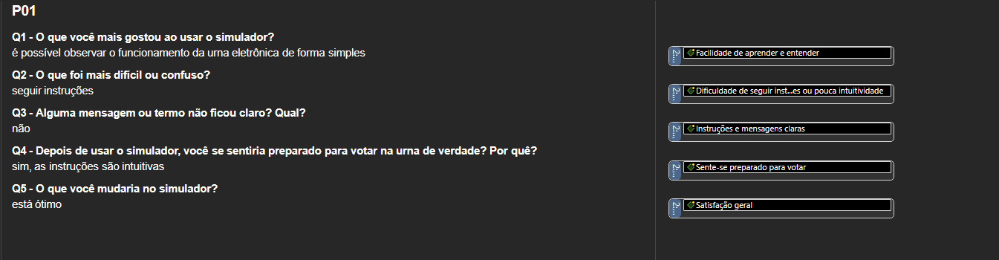
*Figura 5 - Documento do participante P07 no ATLAS.ti, com os trechos das respostas e os códigos associados na margem.*

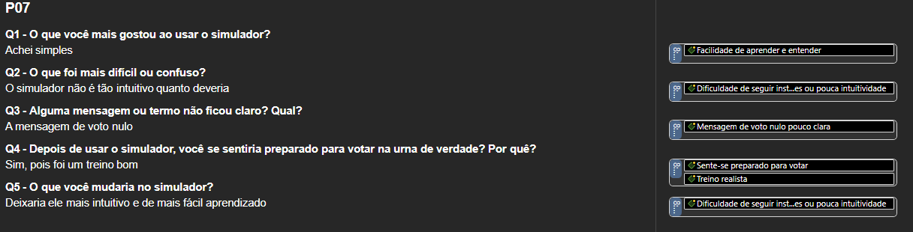
*Figura 6 - Documento do participante P01 no ATLAS.ti, com os trechos das respostas e os códigos associados na margem.*

### 4.3 Códigos identificados

A codificação resultou em 13 códigos (8 positivos e 5 negativos). A Figura 6 mostra a tabela código-documento, e o Quadro 4 resume os códigos por dimensão.

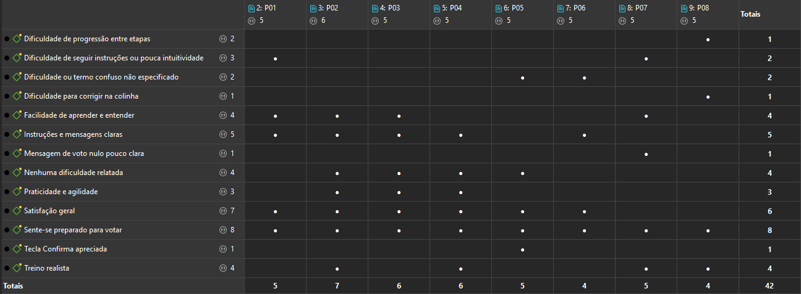
*Figura 7 - Tabela código-documento, com os códigos criados e os participantes que os mencionaram.*

**Quadro 4 - Códigos identificados, por dimensão do UEQ**

| Dimensão do UEQ | Código | Participantes (de 8) | Citações |
| :--- | :--- | :--- | :--- |
| Atratividade | Satisfação geral | 6 | 7 |
| Atratividade | Tecla Confirma apreciada | 1 | 1 |
| Perspicuidade | Instruções e mensagens claras | 5 | 5 |
| Perspicuidade | Facilidade de aprender e entender | 4 | 4 |
| Perspicuidade | Nenhuma dificuldade relatada | 4 | 4 |
| Perspicuidade | Dificuldade de seguir instruções ou pouca intuitividade | 2 | 3 |
| Perspicuidade | Dificuldade ou termo confuso não especificado | 2 | 2 |
| Perspicuidade | Mensagem de voto nulo pouco clara | 1 | 1 |
| Eficiência | Praticidade e agilidade | 3 | 3 |
| Eficiência | Dificuldade de progressão entre etapas | 1 | 2 |
| Confiabilidade | Sente-se preparado para votar | 8 | 8 |
| Confiabilidade | Treino realista | 4 | 4 |
| Confiabilidade | Dificuldade para corrigir na colinha | 1 | 1 |

Os códigos mais frequentes foram "Sente-se preparado para votar" (8 de 8), "Satisfação geral" (6 de 8) e "Instruções e mensagens claras" (5 de 8). As dificuldades (mensagem do voto nulo, correção na colinha e progressão entre etapas) foram citadas por poucos participantes cada.

### 4.4 Redes construídas no ATLAS.ti

Foi criada uma rede para cada dimensão do UEQ, com um memo central que identifica a dimensão e os códigos relacionados a ela. As ligações "contradiz" unem códigos de sentidos opostos, e "está associado com", códigos de sentido semelhante.

#### Atratividade

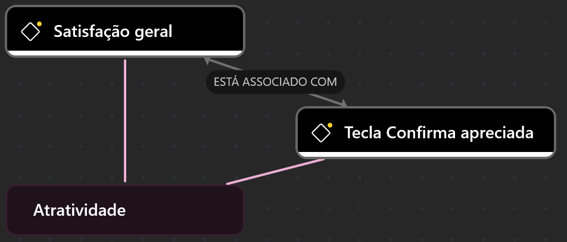

*Figura 8 - Rede da dimensão Atratividade.*

Os dois códigos são positivos. A "Satisfação geral" foi a mais frequente (6 participantes), com respostas como "Tudo" (P06) e "está ótimo" (P01), e P05 destacou a tecla Confirma. Isso converge com o UEQ, em que a Atratividade teve uma das maiores médias (2,188) e a menor variância (0,31).

#### Perspicuidade

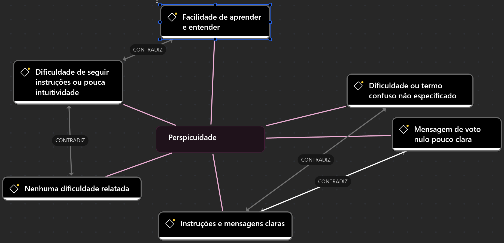

*Figura 9 - Rede da dimensão Perspicuidade.*

É a dimensão com mais códigos (seis). Predominam os positivos: instruções e mensagens claras (5 participantes), facilidade de aprender e entender (4) e nenhuma dificuldade relatada (4). Os negativos foram a pouca intuitividade (P01 e P07), termos confusos sem especificação (P05 e P06) e a mensagem do voto nulo (P07), que combina com a tarefa de votar nulo (M7), concluída com dificuldade por 5 dos 8 participantes. No UEQ, a Perspicuidade também foi positiva (1,750).

#### Eficiência

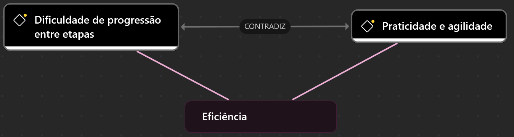

*Figura 10 - Rede da dimensão Eficiência.*

A rede combina a praticidade e a agilidade (P02, P03 e P04) com a dificuldade de progressão entre etapas, citada por P08 ao falar em "prosseguir depois de um passo" e ao sugerir melhorar a progressão. No UEQ, a Eficiência teve a maior média (2,219).

#### Confiabilidade

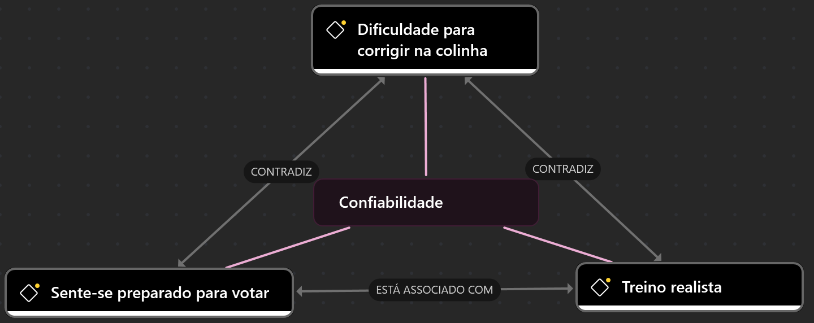

*Figura 11 - Rede da dimensão Confiabilidade.*

Todos os participantes disseram que se sentiriam preparados para votar, e quatro destacaram o valor de um treino realista. Como ponto de atenção, P08 apontou dificuldade para corrigir na colinha, o que se relaciona às dificuldades do teste nas tarefas da colinha (M3) e de correção (M5). No UEQ, a Confiabilidade foi positiva, mas no limite (0,875), e o item "Imprevisível/Previsível" teve a única média negativa (-1,4).

#### Estimulação

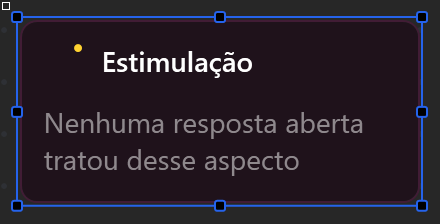

*Figura 12 - Rede da dimensão Estimulação.*

Nenhum código foi associado a esta dimensão: nenhuma resposta tratou de diversão, motivação ou empolgação. Como as perguntas abertas eram gerais, isso indica pouca evidência qualitativa, e não uma avaliação negativa. No UEQ, a Estimulação foi positiva (1,938).

#### Novidade

*Figura 13 - Rede da dimensão Novidade.*

Também não houve códigos associados: nenhuma resposta tratou de criatividade ou originalidade. No UEQ, a Novidade teve a menor média (0,656) e foi a única dimensão neutra, o que combina com a ausência de menções.

Em conjunto, os comentários se concentram em Perspicuidade e Confiabilidade, com predominância de avaliações positivas, e apontam na mesma direção do UEQ, com menos evidência em Novidade.

## 5. Considerações sobre a experiência do usuário

**Percepção dos participantes.** As respostas abertas foram predominantemente positivas: todos disseram que se sentiriam preparados para votar, seis demonstraram satisfação geral e apenas dois (P07 e P08) sugeriram mudanças, sobre intuitividade e progressão entre etapas.

**Convergência com o teste de usabilidade.** Os poucos pontos negativos coincidem com tarefas críticas do teste: a mensagem do voto nulo (M7), a colinha e a correção (M3 e M5) e a progressão entre etapas.

**Diferença entre relato e desempenho.** Apesar do tom positivo, apenas 21 das 64 tarefas foram concluídas sem dificuldade e 13 não foram concluídas. P05 disse não ter tido dificuldade, mas teve 4 erros na tarefa da colinha e não concluiu as tarefas M5 e M6. P06 disse que nenhuma mensagem foi confusa, mas, no teste, não entendeu que o voto seria nulo. Isso pode ter várias explicações, como a tendência de avaliar bem uma ferramenta de treino ou a lembrança parcial da experiência, que este estudo não permite distinguir.

**Resultados do UEQ.** Cinco das seis dimensões foram positivas, com destaque para Eficiência (2,219) e Atratividade (2,188), e a Novidade (0,656) ficou neutra, o que converge com as respostas abertas. Dois pontos do UEQ ajudam a explicar as dificuldades do teste: o item "Imprevisível/Previsível" (-1,4) e a Confiabilidade perto do limite (0,875). Assim, a avaliação geral é positiva, mas a previsibilidade do fluxo (mensagens, correção e progressão entre etapas) merece atenção.

**Limitações.** A amostra é pequena (8 participantes), as respostas abertas são curtas e as perguntas eram gerais, o que deixou Estimulação e Novidade sem evidência qualitativa. No UEQ, dois participantes tiveram respostas inconsistentes em três escalas e foram mantidos, então as médias de Novidade e Confiabilidade exigem cautela. Os resultados refletem a percepção dos participantes e não podem ser generalizados para todos os eleitores.

**Conclusão.** O simulador oferece uma experiência de uso positiva: foi percebido como eficiente, atraente e estimulante, e todos os participantes disseram que se sentiriam preparados para votar. Os pontos que mais merecem atenção são a previsibilidade e a clareza do fluxo, em especial a mensagem do voto nulo, a correção na colinha e a progressão entre etapas, que coincidem com as dificuldades do teste de usabilidade e com a menor avaliação do UEQ. Como a amostra é pequena, os resultados indicam tendências e devem ser confirmados com mais participantes.
