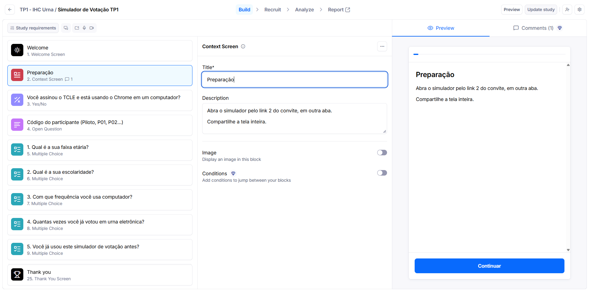

# Configuração do Maze

## 1. Acesso ao Teste
**Link de acesso:** https://t.maze.co/599310546

## 2. Estruturação das Tarefas
O teste foi configurado na ferramenta Maze utilizando as atividades definidas no planejamento. As missões foram inseridas e organizadas de acordo com a sequência cronológica prevista para a simulação da votação.

*Figura 1 – Visão geral das missões configuradas no painel do Maze.*

## 3. Verificação de Funcionamento
Antes da aplicação com os usuários, a equipe testou os fluxos na plataforma para garantir que as instruções estavam claras, os blocos do questionário (caracterização e pós-teste) estavam na ordem correta e a captação de dados ocorreria perfeitamente.
